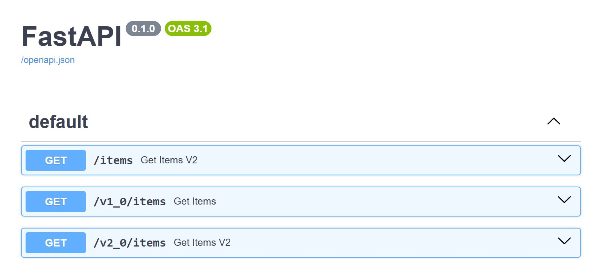

# Adding it to an existing app

You don't have to rewrite anything to start. A route without `@api_version` is given
`default_version`, which is v1.0 under SemVer, so the app you have today is already "version 1".
The steps below keep the unversioned URLs working while your clients move to the versioned ones.

## 1. Versionize what you have

This is an ordinary app, with its router included once:

```python
--8<-- "docs_src/migration/adopt.py:routes"
```

Pass the same router to `RouterVersioner` and call `.versionize()`, leaving everything above as it is:

```python
--8<-- "docs_src/migration/adopt.py:versionize"
```

Nothing is decorated, so `GET /items` is mounted as `GET /v1_0/items`, with its own docs at `/v1_0/docs`.
`GET /items` keeps answering too: `app.include_router(router)` is still there, and `RouterVersioner` doesn't touch it.

## 2. Change an endpoint in a new version

Declare the new one at a higher version, next to the old one. The old function stays exactly as it was:

```python
--8<-- "docs_src/migration/change_endpoint.py:snippet"
```

| URL | Answered by |
|-----|-------------|
| `/items` | the original function, as before |
| `/v1_0/items` | the original function |
| `/v2_0/items` | the new function |

!!! note "The unversioned URL does not follow the new version"

    `/items` is served by the router you included yourself, and FastAPI answers with the first route that matches: the original function. It never moves to v2.0, so clients still on it see no change.

The app's own docs, at `/docs`, list the unversioned URL together with every versioned one, while each version's docs list only its own routes:

{ loading=lazy }

!!! warning "Don't read the unversioned URL from `/docs`"

    FastAPI keeps one operation per path and method in a schema, the last one declared. So `/docs` describes `/items` with the v2.0 function ("Get Items V2" above), while requests to `/items` are answered by the original one. Use `/v1_0/docs` and `/v2_0/docs` as the reference for what each version returns.

## 3. Retire the unversioned URLs

Once your clients call the versioned URLs, remove `app.include_router(router)`. If you still want a URL that always means "the newest", `latest_prefix` adds one:

```python
--8<-- "docs_src/migration/retire_unversioned.py:snippet"
```

`/items` now answers 404, and `/latest/items` serves whichever version is highest: see the [latest alias](advanced/latest-alias.md).

Call `.versionize()` once, after every route is declared, as in the [Quick start](quickstart.md). To take a route out of a version later, or to mark it deprecated first, see the [route lifecycle](lifecycle.md).
